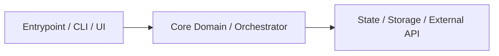

# Truthful README Templates & Diagrams

## High-Signal Architecture Diagram Template (Mermaid)

Only include node IDs and edges directly observed in code:



## AI-Agent Navigation Section Snippet

```markdown
## AI / Agent Navigation Guide
- **Primary entrypoints:** `...`
- **Core logic:** `...`
- **Configuration / Env:** `...` (only document real variables)
- **Verification before commit:** `<exact test/lint command>`
```

## Optional Multilingual Switcher Banner

Use only when translated sibling files actually exist and pass `verify_readme.py`:

```markdown
**Languages:** **English** | [فارسی](./docs/README.fa.md) | [العربية](./docs/README.ar.md)
```

